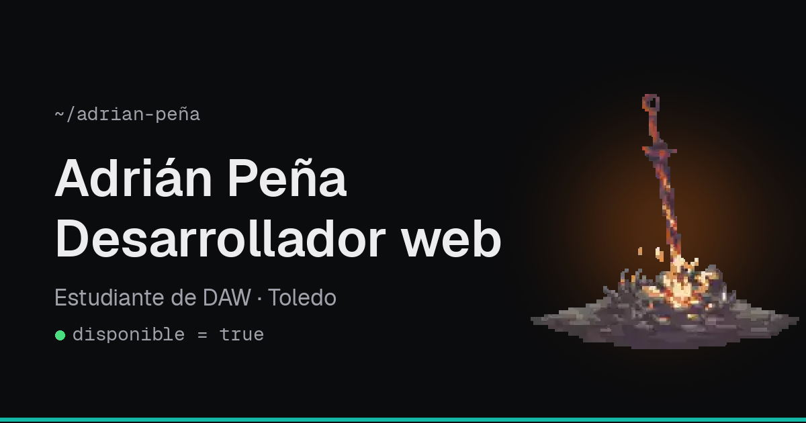

# Portfolio · Adrián Peña

Mi portfolio personal como desarrollador web. Aquí presento quién soy, los proyectos en los que he trabajado, las tecnologías que uso, mi formación y cómo contactar conmigo.

**Web:** [adrianpenia-dev.vercel.app](https://adrianpenia-dev.vercel.app)



## Sobre el proyecto

Es la segunda versión de mi portfolio. La primera tenía una temática de Dark Souls y, aunque me gustaba, no era lo más adecuado para presentarme a una empresa. Así que lo rehice desde cero con un diseño más limpio y profesional, aunque dejé una hoguera como guiño a la versión anterior.

Lo he hecho mientras estudio el CFGS de Desarrollo de Aplicaciones Web en el IES Azarquiel (Toledo).

## Tecnologías

- [Astro](https://astro.build): framework principal
- [Tailwind CSS 4](https://tailwindcss.com): estilos
- TypeScript
- [Fontsource](https://fontsource.org): fuentes Geist y Geist Mono, alojadas en el propio proyecto
- [Devicon](https://devicon.dev): iconos de las tecnologías
- [Vercel](https://vercel.com): despliegue

## Funcionalidades

- Modo claro y oscuro. Recuerda la elección del usuario y respeta la del sistema operativo.
- Presentación escrita como una clase de Java.
- Sección de proyectos con capturas, el problema que resolvía cada uno y las tecnologías usadas.
- Carrusel con las tecnologías y herramientas que manejo.
- Diseño responsive para móvil, tablet y escritorio.
- Página 404 propia.
- SEO básico y Open Graph, para que el enlace se vea bien al compartirlo en LinkedIn o WhatsApp.
- Accesibilidad: navegación con teclado, enlace para saltar al contenido, buen contraste de colores y respeto a la opción de reducir animaciones.

## Cómo ejecutarlo en local

### Requisitos

- [Node.js](https://nodejs.org) 22.22 o superior
- npm

### Pasos

```bash
# 1. Clonar el repositorio
git clone https://github.com/Adriz33/portfolio.git
cd portfolio

# 2. Instalar las dependencias
npm install

# 3. Arrancar el servidor de desarrollo
npm run dev
```

La web se abre en `http://localhost:4321`.

> **Nota para Windows:** si usas PowerShell y te da un error de scripts al ejecutar `npm`, prueba con `npm.cmd` o usa Git Bash.

### Comandos

| Comando           | Qué hace                                         |
| ----------------- | ------------------------------------------------ |
| `npm run dev`     | Arranca el servidor de desarrollo                |
| `npm run build`   | Genera la web final en la carpeta `dist/`        |
| `npm run preview` | Muestra en local la versión generada con `build` |

## Estructura

```text
portfolio/
├── public/              # Archivos que se sirven tal cual (favicon, imagen para compartir, hoguera)
├── src/
│   ├── assets/          # Imágenes que optimiza Astro (foto de perfil y capturas)
│   ├── components/      # Una pieza por sección: Header, Hero, Projects, Stack...
│   ├── data/
│   │   └── projects.ts  # Datos de los proyectos
│   ├── layouts/
│   │   └── Layout.astro # Estructura común de todas las páginas y etiquetas SEO
│   ├── pages/
│   │   ├── index.astro  # Página principal
│   │   └── 404.astro    # Página de error
│   └── styles/
│       └── global.css   # Colores, fuentes y animaciones
└── astro.config.mjs
```

Para añadir un proyecto nuevo solo hay que añadir un objeto en `src/data/projects.ts` y su captura en `src/assets/proyectos/`.

## Despliegue

La web está desplegada en Vercel y conectada a este repositorio. Cada vez que hago `git push` a la rama `main`, Vercel genera la web y la publica automáticamente.

## Lo que he aprendido

- Organizar una web en componentes y separar los datos del diseño.
- Crear un modo claro y oscuro con variables CSS.
- Etiquetas de SEO y Open Graph, y por qué necesitan URLs absolutas.
- Pequeños detalles de accesibilidad que antes no tenía en cuenta.
- Leer los errores con calma en vez de cambiar cosas a ciegas.
- Trabajar con Git de forma más ordenada y desplegar de forma continua.

## Contacto

- Email: [adriz6149@gmail.com](mailto:adriz6149@gmail.com)
- LinkedIn: [Adrián Peña Gómez](https://linkedin.com/in/adrian-peña-gómez97)
- GitHub: [@Adriz33](https://github.com/Adriz33)
